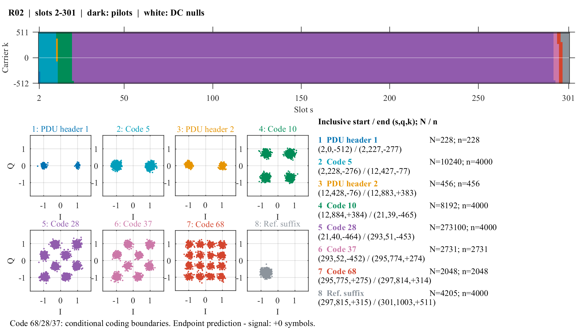
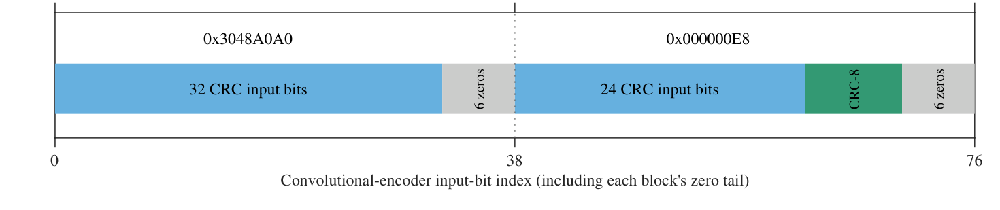
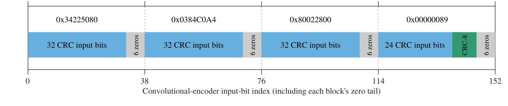

**English** | [简体中文](README.zh-CN.md)

[Research paper (PDF)](paper/Starlink_Downlink_Analysis.pdf) · [Download IQ CSV (311 MB)](https://github.com/misaka666/Starlink-Downlink-Analysis/releases/download/v1.0.0/Starlink_Downlink_IQ.csv) · [Release v1.0.0](https://github.com/misaka666/Starlink-Downlink-Analysis/releases/tag/v1.0.0)

---

# Inside the Starlink Downlink: Frame Structure, PDU Headers, and Payload Coding

A spectrum or constellation plot can reveal the bandwidth and modulation features of a Starlink downlink recording. Explaining which resources carry headers, how those headers describe the payload, and which channel codes protect each region requires a more complete connection between the waveform, decoded control bits, and coding relations.

This article summarizes our analysis of a Starlink Ku-band downlink recording. The data come from a single continuous capture lasting approximately 24 ms, with 18 complete frames included in the analysis. We identify two protocol data unit headers in each frame, recover their convolutional code and CRC, and relate modulation and coding scheme fields to subsequent resource allocations. We also recover and validate coding relations for several payload formats.

The focus here is **what we can currently say about the contents of a frame**. We briefly review the established synchronization and pilot structure, then concentrate on the headers, resource allocations, and payload coding. Format numbers follow the MCS index interpretation used in the current manuscript.

## 1. The Basic Frame Structure

The recording contains complex baseband samples after downconversion and upstream coarse carrier synchronization. Its sampling rate is 480 MHz, and its 11,520,180 samples span 24.000375 ms. Although the recording was stored in multiple files, those files contain one continuous capture.

The main time–frequency parameters and synchronization sequences of the Starlink downlink have already been described in public research. We use the frame grid established by [Humphreys et al.](https://arxiv.org/abs/2210.11578), together with the edge-pilot references described by [Qin et al.](https://doi.org/10.1038/s44459-026-00075-6). These known structures provide the basis for the analysis below.

| Parameter | Value or representation used here |
| --- | --- |
| Receiver sampling rate | 480 MHz |
| Ordinary OFDM FFT / cyclic prefix | 2048 / 64 on the receiver grid, equivalent to 1024 / 32 at 240 MHz |
| Subcarrier spacing | 234.375 kHz |
| Ordinary slot duration | 4.4 μs, including the cyclic prefix |
| Nominal frame rate / period | 750 frames/s, approximately 1.333333 ms |
| Occupied slot intervals per frame | 302, numbered 0–301 |
| Resource interval analyzed below | Slots 2–301, comprising 300 OFDM symbols |
| Loaded subcarriers per ordinary slot | 1020, including 16 edge pilots |
| Non-pilot resources per ordinary slot | 1004 |
| Non-pilot resources across slots 2–301 | 301,200 modulation symbols |

Two uses of the word “symbol” need to be distinguished. One OFDM symbol occupies one slot. A complex value on one subcarrier in one slot is a **modulation symbol**. When we say that an allocation contains 8192 symbols, we mean 8192 subcarrier modulation symbols.

Using the terminology of the published frame description, a frame contains the PSS, SSS, ordinary body, CM1SS, CSS, and inter-frame guard. The primary synchronization sequence (PSS) occupies slot 0, and the secondary synchronization sequence (SSS) occupies slot 1. CM1SS and CSS are the published names associated with slots 300 and 301. In our recording, CM1SS and CSS are not identical in every frame, so those positions cannot simply be treated as universally fixed synchronization content.

In frequency, the equivalent loaded-carrier indices run from −512 to −3 and from +2 to +511, leaving four central nulls. The 16 edge pilots occupy −496 through −489 and +488 through +495. Nine narrowband spectral lines are also visible to the left of the occupied OFDM band. They are separate from the 16 pilots within the OFDM grid.

## 2. Reading the Resource Coordinates

We identify a resource by `(s, q, k)`. Here, `s` is the frame-local slot index, `k` is the signed subcarrier index, and `q` is the resource ordinal within that slot after skipping pilots and DC nulls. The range of `q` is 0–1003.

For example, `(2, 0, −512)` is the first non-pilot resource in slot 2, on subcarrier −512. The coordinate `(12, 883, +383)` refers to non-pilot ordinal 883 in slot 12, on subcarrier +383.

Headers and payload are ordered **from lower to higher frequency within a slot, followed by the next slot**. Two fields can therefore occupy different subcarriers in the same slot. Their boundary does not have to coincide with the start of an OFDM symbol.

We use **R02** as the worked example throughout this article. R02 is the record identifier for the frame at zero-based index 2 in the first storage file of the continuous recording.



*Figure 1. R02 resource allocations across slots 2–301. The upper panel shows slot versus subcarrier, with colors identifying the regions. The lower panels show received constellations after equalization and PN reference-phase removal, together with inclusive start and end coordinates. Pilots are dark, and DC nulls are white. In this figure, N is the total number of symbols in a region, while n is the number of received points displayed, capped at 4000.*

## 3. A Common Phase Convention for the Constellations

Before interpreting Figure 1, we need to specify how its constellation samples were processed.

After frequency, timing, and channel correction, the received symbols can still include a four-phase rotation that varies with resource position. We denote the corresponding reference coefficient by `R(s,k)`. Under the declared receiver convention, it takes values in `1, j, −1, −j`. Multiplying an equalized symbol by the conjugate of its reference coefficient removes that phase rotation.

This is compatible with the rotational scrambling mechanism disclosed in the SpaceX patent. We do not present PN phase rotation as a new discovery. Instead, we test a reference consistent with that public mechanism against the received data. [US12074683B1](https://patents.google.com/patent/US12074683B1/en)

One verification uses the known edge pilots. After estimating sequence components from slots 17–31 and selecting a fixed binary bias using slot 32, the fixed model predicts **all 4304 pilot phase labels in slots 33–301 without disagreement**. This test uses known pilot symbols. It does not require the higher-order payload symbols in those slots to have fixed values.

Across 16 complete frames with detailed leading-region statistics, all 274,334 tested symbols satisfy the predicted phase-pair relation. After reference-phase removal, they form a two-point BPSK constellation, with EVM ranging from 0.1329 to 0.1536.

**All payload constellations shown below use PN reference-phase removal.** This gives a common basis for interpreting modulation and coding, but does not recover application plaintext. The plotted points are noisy received observations. They are neither hard-decision replacements nor the result of fitting a separate phase rotation to each region.

## 4. Two PDU Headers in Each Frame

Each of the 18 analyzed frames contains two coded units, each protected by a CRC covering that unit. Based on their relationships to the following resources and the patent's protocol data unit description, we refer to them as the first and second **PDU headers**. PDU stands for *protocol data unit*.

### Short Convolutionally Encoded Blocks

Each coding block occupies **114 BPSK resources**. It takes 32 retained bits and six zero tail bits as input to a rate-1/3 convolutional encoder:

```text
32 retained bits + 6 zero tail bits
              ↓ rate-1/3 convolutional encoding
          114 coded bits
              ↓ BPSK mapping
          114 modulation symbols
```

The recovered convolutional code has constraint length seven. Under the register direction and output ordering declared in the manuscript, its generator polynomials are **(155, 123, 137) in octal**.

The 32 retained bits are not necessarily 32 bits of user data. In the final coding block, they include the header CRC. The six zero tail bits terminate the encoder state for that block and are excluded from the CRC calculation.

The first PDU header always contains two coding blocks, occupying 228 resources from `(2,0,−512)` through `(2,227,−277)`. The second PDU header has three observed lengths.

| Header | Coding blocks | Coded resources | Retained bits after tail removal | CRC input bits |
| --- | ---: | ---: | ---: | ---: |
| First header | 2 | 228 | 64 | 56 |
| Second header: shortest form | 2 | 228 | 64 | 56 |
| Second header: intermediate form | 3 | 342 | 96 | 88 |
| Second header: longest observed form | 4 | 456 | 128 | 120 |

The second header also changes position. It occurs in slot 8 in four frames, slot 12 in five frames, and slot 14 in nine frames. The slot-12 cases include both three-block and four-block headers. **The second header is therefore not a fixed “slot-12 header.”**

### A CRC Over the Header, Not the Entire Frame

After removing the six tail bits from each block, we concatenate the 32 retained bits from successive blocks in resource order. The final eight bits are the received CRC. All preceding retained bits form the CRC input.

The recovered parameters are polynomial `x^8 + x^6 + x^3 + x^2 + 1`, eight-bit mask `0x4D`, initial register `0xFF`, final XOR zero, most-significant-bit-first processing, and no input or output reflection.



*Figure 2. The first R02 header contains two coding blocks. Blue denotes the 56 CRC input bits, green the final CRC byte, and gray the six zero tail bits of each block. The horizontal axis counts encoder input positions, including tails, rather than transmitted coded resources.*



*Figure 3. The second R02 header contains four coding blocks. Blue totals 120 CRC input bits, green is the eight-bit CRC, and gray tails are excluded from the CRC calculation. All colored segments pass through convolutional encoding before transmission.*

The decoded words of R02's first header are `0x3048A0A0` and `0x000000E8`. Computing the CRC over the first 56 retained bits gives `0xE8`, matching the received byte. Its second header contains `0x34225080`, `0x0384C0A4`, `0x80022800`, and `0x00000089`. The 120 input bits give `0x89`.

After fixing the CRC parameters selected using six headers, all 30 remaining headers pass. Across **18 frames and 36 headers, there are no CRC disagreements**. The CRC bits themselves are convolutionally encoded. They are not inserted into the modulation stream as an uncoded byte.

## 5. How the Headers Describe the Following Resources

After tail removal, the current conditional layout is:

```text
16-bit candidate prefix
+ D × 20-bit MCS index–length pairs
+ remaining zero-valued bits
+ 8-bit CRC
```

Some prefix bits correlate with the header role, number of coding blocks, and number of following MCS pairs. The first 16 bits of the first header are identical across all 18 frames. Four prefix patterns occur in the second headers.

Here, `D` is the number of MCS index–length pairs. It is different from the number of 114-bit blocks making up the header and from the total number of payload codewords.

### MCS Index and Quantity

We retain two interpretations of each 20-bit unit:

```text
Candidate 1: 7-bit MCS index + 1 unresolved bit + 12-bit quantity
Candidate 2: 8-bit MCS index                    + 12-bit quantity
```

Within each field, the received bits are assigned increasing binary weights from left to right. The eighth bit is zero in all 52 observed units. Both interpretations therefore produce the same indices and quantities, and the current data cannot distinguish them.

In the working model, the quantity specifies a **candidate codeword count** for the associated format, rather than a byte count. For example, the first headers in R00, R02, and R03 give quantities of 6, 5, and 3. The BPSK regions between their two headers contain 12,288, 10,240, and 6144 symbols, respectively: exactly 2048 times those quantities. This relationship holds for the first header in all 18 frames.

This functional interpretation is compatible with the patent's distinction between an MCS field specifying coding and modulation and an MCS length field specifying payload size. The units and field widths still need to be established from the received signal, rather than copied from the patent. [US12074683B1](https://patents.google.com/patent/US12074683B1/en)

### From a Quantity to an Allocation Length

The quantity alone is not enough. We also need the format's candidate codeword length and the number of coded bits mapped to each modulation symbol. The resource rule used here is:

```text
Symbols per codeword = ceil(codeword bits / coded bits per symbol)
Symbols in allocation = codeword count × symbols per codeword
```

The important detail is that **each codeword is rounded up separately**. For code 28, the candidate complete length is 16,384 bits, with three bits mapped to each symbol. Each codeword requires 5462 symbols. R02 specifies 50 such units, giving 273,100 symbols. Concatenating all 50 codewords before rounding would instead give 273,067 symbols, a difference of 33.

The 5462-symbol spacing has support beyond that length calculation. After fixing a pair of allowed final-symbol points, the last symbols of another 89 candidate codewords all satisfy the restriction. Moving those boundaries by 1–8 symbols in either direction does not preserve complete agreement. This supports a separate final modulation symbol for each codeword, without by itself establishing the complete encoder.

**The 20-bit layout is a supported working model, not a uniquely established layout.** A 19-bit candidate also passes the header-capacity and residual-zero tests, and the revised index interpretation does not uniquely reject it. The prefix boundary, full quantity-field width, and meaning of the residual zeros require further evidence.

## 6. A Complete Allocation Map for R02

R02's first header gives one MCS pair, `(5,5)`. The second gives four: `(10,1)`, `(28,50)`, `(37,1)`, and `(68,1)`. Each pair lists the index followed by the quantity.

Combining these fields with the received resources and coding results gives the following map. Coordinates are inclusive, and symbol counts exclude pilots and DC nulls.

| Region | Contents | Start `(s,q,k)` | End `(s,q,k)` | Modulation symbols |
| --- | --- | --- | --- | ---: |
| 1 | First PDU header | `(2,0,−512)` | `(2,227,−277)` | 228 |
| 2 | Code 5, five codewords | `(2,228,−276)` | `(12,427,−77)` | 10,240 |
| 3 | Second PDU header | `(12,428,−76)` | `(12,883,+383)` | 456 |
| 4 | Code 10, one codeword | `(12,884,+384)` | `(21,39,−465)` | 8192 |
| 5 | Code 28, 50 candidate complete units | `(21,40,−464)` | `(293,51,−453)` | 273,100 |
| 6 | Code 37, one candidate complete unit | `(293,52,−452)` | `(295,774,+274)` | 2731 |
| 7 | Code 68, quantity one | `(295,775,+275)` | `(297,814,+314)` | 2048 |
| 8 | Reference-symbol padding | `(297,815,+315)` | `(301,1003,+511)` | 4205 |

The eight regions total **301,200 non-pilot symbols**, covering slots 2–301.

Figure 1 shows that the first header, code 5, and second header all have two-point constellations. Code 10 is QPSK, codes 28 and 37 have eight points, and code 68 has sixteen-point observations. **The same constellation does not imply the same code, and an unchanged constellation does not imply the absence of an allocation boundary.**

## 7. What Has Been Recovered About Payload Coding?

In the table below, `N` is the number of coded bits and `K` is the systematic input dimension. Neither directly specifies the amount of application data or its meaning.

| MCS index | Constellation after PN removal | Verified coding relation | Rate | Symbols per complete allocated unit |
| --- | --- | --- | --- | ---: |
| 5 | BPSK | QC-LDPC, `N=2048, K=1024` | 1/2 | 2048 |
| 9 | BPSK | QC-LDPC, `N=2048, K=1280` | 5/8 | 2048 |
| 3 | BPSK | QC-LDPC, `N=8192, K=4096` | 1/2 | 8192 |
| 12 | QPSK | Shares the code-3 encoder | 1/2 | 4096 |
| 27 | Eight-point subset | Shares the code-3/12 encoder | 1/2 | 2731 |
| 10 | QPSK | QC-LDPC, `N=16384, K=8192`, subject to structured-completion conditions | 1/2 | 8192 |
| 39 | 16QAM | Shares the code-10 encoder | 1/2 | 4096 |
| 21 | QPSK | QC-LDPC, `N=8192, K=5120` | 5/8 | 4096 |
| 28 | Eight-point subset | Recovered shortened core: `N=16128, K=8960`; another 256 bits remain unexplained | Core: 5/9 | 5462 |
| 37 | Eight-point subset | Recovered shortened core: `N=7808, K=4736`; another 384 bits remain unexplained | Core: 37/61 | 2731 |
| 68 | Sixteen-point observations | Encoder, information dimension, and rate unresolved | Unknown | 2048 in R02 |

QC means *quasi-cyclic*: the coding matrices can be represented using circulant blocks. LDPC means *low-density parity-check*. Establishing an LDPC representation requires a complete sparse parity-check relation, rather than a successful decoding result alone.

Several sharing relationships are particularly useful: **codes 10/39 and codes 3/12/27 reuse the same coding relations with different modulations**. Code 37 also admits a shortened core obtained by fixing part of the input of the recovered code-21 encoder to zero.

For code 28, the verified core contains 8960 systematic bits and 7168 parity bits, totaling 16,128 bits. The candidate complete transmitted unit has 16,384 bit positions, with 256 observed bits still unexplained. Code 37 has a core of 4736 systematic bits and 3072 parity bits, with another 384 observed bits unexplained. Neither result establishes complete decoding of the entire allocated field.

The patent describes adding pseudorandom bits when LDPC output does not fill the allocated resources, providing a possible explanation for the extra bits. However, in the receiver ordering used here, those bits occur between the identified systematic and parity segments. Their generation rule and any intervening permutation remain unconfirmed. [US12074683B1](https://patents.google.com/patent/US12074683B1/en)

A separate constellation distinction matters for codes 27, 28, and 37. We observe eight-point subsets of a sixteen-point grid, with unequal point magnitudes, so these observations should not simply be called constant-envelope 8PSK. Some rows in the [example MCS table in US11792832B1](https://patents.google.com/patent/US11792832B1/en) use the name 8PSK. Matching numerical parameters does not establish the same constellation or complete coding matrix.

### Evidence Behind the Coding Results

These conclusions rely on more than counting constellation points or matching a parameter table. A recovered generator must predict parity bits, a recovered sparse parity-check matrix must satisfy the complete coding relations, and decoding, re-encoding, and remodulation must remain consistent with the received waveform.

For example, after fixing the generators for codes 5, 9, and 21, they predict **78,848, 9984, and 811,008 parity bits, respectively, without disagreement**, on codewords excluded from their corresponding generator fits. The fixed code-28 encoder also predicts **637,952 core parity bits without disagreement** on another 89 codewords.

In the signal domain, remodulation gives normalized mean-square error (NMSE) of approximately 0.0185 for code 39 and 0.0284 for code 27. Deliberately flipping the encoded parity bits substantially increases the error. These comparisons show that the recovered coding relations and bit mappings can explain noisy received symbols.

The strength of the validation differs across formats. Code 10 involves finite structured completion under rank deficiency. Codes 39 and 27 each have only one target-format field, and their mappings were selected on that field. All records come from the same continuous capture, with some observations inspected during model selection. Exclusion from a generator fit therefore does not mean the data were previously unseen throughout identification, and zero disagreement is not a measurement of channel bit-error rate.

## 8. Why Does the End of the Frame Collapse to One Point?

The final region in Figure 1 remains close to a constant after PN removal. Before removal, the same observations remain close to the position-dependent reference `R(s,k)`. We call this observed behavior **reference-symbol padding**.

The region still carries received power. It is different from the silent inter-frame guard. Its constellation does not necessarily appear at exactly `+1`, because the frame-wide gain and phase normalization can change the displayed constant.

This behavior provides a signal-based indication of the payload endpoint. The first individual symbol close to the reference is not sufficient, because a payload symbol can coincide with it by chance. Instead, the test evaluates the full interval, explaining observations before a candidate boundary as varying payload and those after it as persistent reference symbols. It selects the transition with the best overall agreement.

For R02, the signal-based estimate places the start of padding at `(297,815,+315)`, leaving 4205 non-pilot symbols. This agrees with the prediction obtained by accumulating the MCS allocation lengths. Across all 18 frames, **16 endpoints agree exactly, and the other two differ by one and two symbols**.

This supports the overall allocation-length interpretation. It does not independently establish every internal modulation boundary or prove that a reference-consistent tail carries no information. It is also a behavior observed in this capture, rather than a requirement that every Starlink frame use the same terminal content.

## From a Constellation Plot to a Frame Description

The main result is the connection between several layers of the received frame. Synchronization and pilots establish the time–frequency grid. Two PDU headers pass convolutional decoding and CRC checks. MCS indices and quantities describe following allocations. Parity prediction and remodulation then support several payload coding relations.

Formats such as codes 5, 9, and 21 now have explicit recovered coding relations, and several encoder-sharing relationships have been verified. Open questions include the complete header field widths, uniqueness of the 20-bit layout, some higher-layer field meanings, the extra bits in codes 28 and 37, and the encoder for code 68. These results do not directly recover application-layer content.

The practical advance is that a frame can now be presented as a resource map with coordinates, modulation, and coding status, with decoded header contents checked against the actual received signal.

---

### Public References

- Humphreys et al., [Signal Structure of the Starlink Ku-Band Downlink](https://arxiv.org/abs/2210.11578): principal downlink time–frequency parameters and synchronization sequences.
- Qin et al., [Pilots and Other Predictable Elements of the Starlink Ku-Band Downlink](https://doi.org/10.1038/s44459-026-00075-6): edge pilots and predictable reference elements.
- SpaceX, [US12074683B1](https://patents.google.com/patent/US12074683B1/en): public descriptions of downlink OFDM, header processing, and payload processing.
- SpaceX, [US11792832B1](https://patents.google.com/patent/US11792832B1/en): adaptive modulation and coding, including an illustrative MCS table.

*This article is a technical overview of our research manuscript, “Protocol Data Unit Header Decoding and Payload Coding Recovery in the Starlink Ku-Band Downlink.” Numerical results and their scope follow the experimental definitions in that manuscript.*
