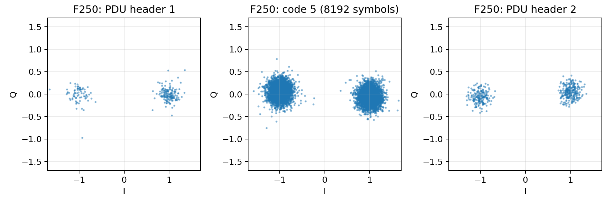
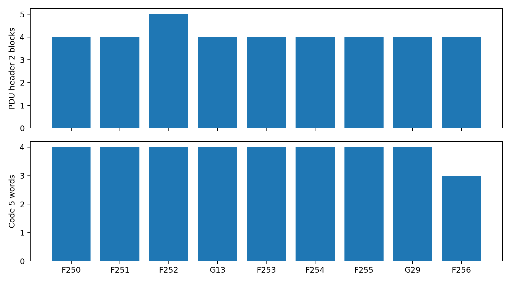

[English](README.md) | **简体中文**

[下载原始IQ（50 MB）](https://github.com/misaka666/Starlink-Downlink-Analysis/releases/download/v2.0.0/Starlink_Downlink_IQ_250MSps.bin) · [数据格式](data/README.md) · [原研究论文PDF](paper/Starlink_Downlink_Analysis.pdf)

# 新采集9个完整帧：PDU头部与code5验证

本页以新的250 MS/s原始IQ记录为依据，不把原18帧论文中的全部编码结论当作本记录的验证结果。原始记录长50 ms，其中确认9个完整可解析帧；另有截断F257及未通过当前接收链确认的候选，均不计入下列结果。F250等是提供的记录编号，G13／G29是额外检出的候选编号，不是空口sequence number。

## 数据与接收处理

记录为小端交织int16 I/Q，共1250万复样本。采用24/25有理重采样到240 MHz处理网格，FFT1024、CP32，slot 0／1为PSS／SSS，slot 2–301含301200个非导频非DC资源。接收链包括同步、频偏及采样偏差校正、信道均衡、导频相位校正和冻结PN相位参考去除。下图保留含噪接收点，没有以理想重编码星座替代。



## 两个PDU头部

9帧共18组，通过冻结的约束长度7、率1/3卷积码，生成元八进制(155,123,137)，以及CRC8检验。每个独立终止块为32位保留信息加6个零尾位，产生114编码位；最后一个保留字的末8位为组CRC。CRC多项式为x^8+x^6+x^3+x^2+1，掩码0x4D，初值0xFF，最终异或0，无反射、MSB-first。CRC计算排除每块尾位，CRC本身也经过卷积编码，不是整帧末尾校验。

首头部均占228个资源，从(2,0,-512)到(2,227,-277)。其后code5在前8个完整帧含4个2048位字，F256含3个字。第二头部在前8帧从(10,388,-116)开始，F256从(8,348,-156)开始。F252第二头部含5块、570个资源，其余含4块、456个资源。该组统计共55块。

|Frame / 帧|TOA (ms)|code5 words|PDU2 blocks|PDU2 candidate fields|
|---|---:|---:|---:|---:|
|F250|0.500000|4|4|5|
|F251|7.166683|4|4|4|
|F252|12.500029|4|5|6|
|G13|17.833371|4|4|5|
|F253|23.166712|4|4|5|
|F254|28.500021|4|4|5|
|F255|33.833362|4|4|4|
|G29|39.166692|4|4|5|
|F256|44.500021|3|4|4|




## code5：冻结旧编码器在新数据上成立

code5为去PN参考相位后的BPSK，完整QC-LDPC等价表示(N,K)=(2048,1024)，率1/2、提升因子128。保留前1024位系统位和后1024位校验位的声明坐标，使用冻结P、H，不用新数据重新拟合矩阵。

9帧共35字。34字直接硬判决满足校验；G29有一个校验硬位需要纠正。纠正后35字均满足完整H，重编码零差异，共35840个校验位一致。原始校验位预测只有1位差异，不能将纠错后的零差异表述成信道BER为零。逐帧结果及PDU译码字见data目录。

F250实例：PDU1为228资源，接下来4×2048=8192个code5资源，从(2,228,-276)到(10,387,-117)，再接456资源PDU2，从(10,388,-116)到(10,843,+343)。坐标端点均包含，q排除导频和直流空载波。

## MCS及验证边界

首头部的代码5及数量4／3与实际编码字数对应。第二头部解出了变化的候选MCS索引—数量信息，但本页不据旧采集直接确认其余载荷编码。19位及20位排列都能通过本组的部分排列检查，20位仍为条件工作模型；更宽索引解释应与旧六位标签区分。不能将同为BPSK的帧尾认作code5或固定参考填充，也不能把旧例的4205符号尾段推广到这里。

公开专利[US11792832B1 Fig.4](https://patents.google.com/patent/US11792832B1/en)索引0给出BCC-BPSK、名义率1/3、N=114／K=32，与头部关键配置兼容。[US12074683B1](https://patents.google.com/patent/US12074683B1/en)提供头部与MCS／长度字段的功能线索。这些对应支持解释，但不认证发送端标准身份，也不代替实测编码验证。

本仓论文PDF保留为原研究文献，其18帧实验不是本页9帧验证统计。数据文件说明、采样格式和下载链接以当前data目录为准。

## Citation

If you use this dataset, analysis, or research results in your work, please cite our arXiv paper:

Haoyan Liu, Yichuan Ma, Haotong Zhao, Chengguang Li, and Min Yang. **[Protocol Data Unit Header Decoding and Payload Coding Recovery in the Starlink Ku-Band Downlink](https://arxiv.org/abs/2610.29387v2)**. arXiv:2610.29387v2 [eess.SP], 2026 (version 2).

```bibtex
@misc{liu2026starlinkdownlink,
  title         = {Protocol Data Unit Header Decoding and Payload Coding Recovery in the {Starlink} {Ku-Band} Downlink},
  author        = {Haoyan Liu and Yichuan Ma and Haotong Zhao and Chengguang Li and Min Yang},
  year          = {2026},
  eprint        = {2610.29387v2},
  archivePrefix = {arXiv},
  primaryClass  = {eess.SP},
  note          = {Version 2},
  url           = {https://arxiv.org/abs/2610.29387v2}
}
```
