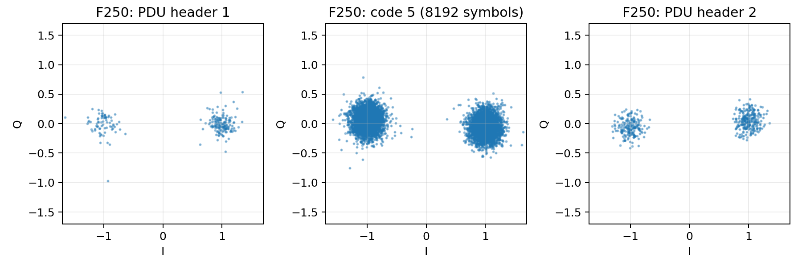
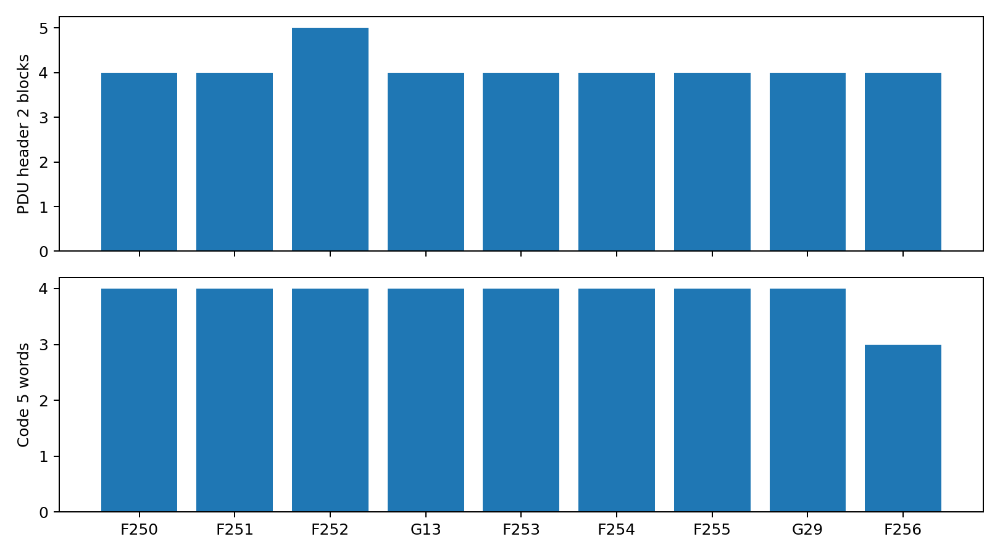

# Nine complete frames from a new capture: PDU headers and code 5

This report concerns the new 250 MS/s raw IQ recording. It does not transfer all coding conclusions from the original 18-frame paper to this capture. The unmodified 50 ms record contains nine complete validated frames, additional candidates, and truncated F257. Only the nine complete frames enter the statistics below. F250-style labels are supplied record identifiers; G13/G29 identify additional detected candidates, not decoded sequence numbers.

## Data and receiver

The recording contains 12,500,000 complex samples as little-endian interleaved signed int16 I,Q. Receiver processing resamples by24/25 to an equivalent240 MHz grid with FFT1024 and CP32. Slots0/1 carry PSS/SSS; slots2–301 contain301200 non-pilot, non-DC resources. Acquisition, frequency/timing correction, channel equalization, pilot phase correction and frozen PN reference removal precede analysis. Constellations show noisy observations, not hard-decided replicas.



## Two PDU headers

All18 headers pass the frozen constraint-length-seven rate-1/3 convolutional encoder, octal generators(155,123,137), termination and CRC8 checks. Each block retains32 bits and appends six zero-tail inputs to produce114 coded bits. The last eight retained bits of a group are its CRC. The polynomial is x^8+x^6+x^3+x^2+1, mask0x4D, init0xFF, xorout0, MSB-first, without reflection. Tail bits are excluded from CRC input; the CRC itself is convolutionally encoded.

Header1 occupies228 resources from(2,0,-512) to(2,227,-277). The intervening code5 allocation contains four2048-bit words in eight frames, and three in F256. Header2 starts at(10,388,-116), except F256 at(8,348,-156). It contains five blocks/570 resources in F252 and four blocks/456 resources otherwise. There are55 header coding blocks in this nine-frame subset.

|Frame / 帧|TOA (ms)|code5 words|PDU2 blocks|PDU2 candidate fields|
|---|---:|---:|---:|---:|
|F250|0.500000|4|4|5|
|F251|7.166683|4|4|4|
|F252|12.500029|4|5|6|
|G13|17.833371|4|4|5|
|F253|23.166712|4|4|5|
|F254|28.500021|4|4|5|
|F255|33.833362|4|4|4|
|G29|39.166692|4|4|5|
|F256|44.500021|3|4|4|




## Code5 validation with a frozen encoder

Code5 is BPSK after PN reference removal, with a complete equivalent QC-LDPC representation N=2048,K=1024,rate1/2,Z=128. The declared layout places1024 systematic bits before1024 parity bits. The prior P/H matrices are frozen, not re-fitted to this capture.

The nine frames contain35 words. Thirty-four hard-decision words directly satisfy the checks; G29 requires correction of one parity hard bit. All35 corrected words satisfy the complete H and re-encode without disagreement, covering35840 parity bits. There is one disagreement in prediction of the original received parity. Zero post-decoding disagreements are not a measurement of zero channel BER.

For F250, header1 uses228 resources, followed by4×2048=8192 code5 resources from(2,228,-276) to(10,387,-117), then456 resources of header2 from(10,388,-116) to(10,843,+343). Endpoints are inclusive; q excludes pilots and DC. Machine-readable per-frame results and decoded header words are in data/.

## MCS interpretation and limitations

Header1's code5 quantity4/3 agrees with the observed word counts. Header2 yields varying candidate MCS index–quantity fields, but other payload encoders are not established here by copying the old capture's table. Both19- and20-bit packing interpretations pass partial checks in this subset;20 bits remains conditional. Wider index interpretations must be distinguished from the saved six-bit labels. A BPSK suffix is not automatically code5 or constant-reference padding. The old4205-symbol suffix is not assumed for these frames.

[US11792832B1 Fig.4](https://patents.google.com/patent/US11792832B1/en) lists index0 as BCC-BPSK, nominal rate1/3,N=114,K=32, compatible with the header configuration. [US12074683B1](https://patents.google.com/patent/US12074683B1/en) supplies functional header/MCS-length descriptions. Compatibility does not authenticate a transmitter-standard identity or substitute for received-data coding checks.

The paper PDF remains the original research publication; its18-frame results are not the nine-frame statistics reported here. Current dataset details and download links are in data/.

## Citation

If you use this dataset, analysis, or research results in your work, please cite our arXiv paper:

Haoyan Liu, Yichuan Ma, Haotong Zhao, Chengguang Li, and Min Yang. **[Protocol Data Unit Header Decoding and Payload Coding Recovery in the Starlink Ku-Band Downlink](https://arxiv.org/abs/2610.29387v2)**. arXiv:2610.29387v2 [eess.SP], 2026 (version 2).

```bibtex
@misc{liu2026starlinkdownlink,
  title         = {Protocol Data Unit Header Decoding and Payload Coding Recovery in the {Starlink} {Ku-Band} Downlink},
  author        = {Haoyan Liu and Yichuan Ma and Haotong Zhao and Chengguang Li and Min Yang},
  year          = {2026},
  eprint        = {2610.29387v2},
  archivePrefix = {arXiv},
  primaryClass  = {eess.SP},
  note          = {Version 2},
  url           = {https://arxiv.org/abs/2610.29387v2}
}
```
