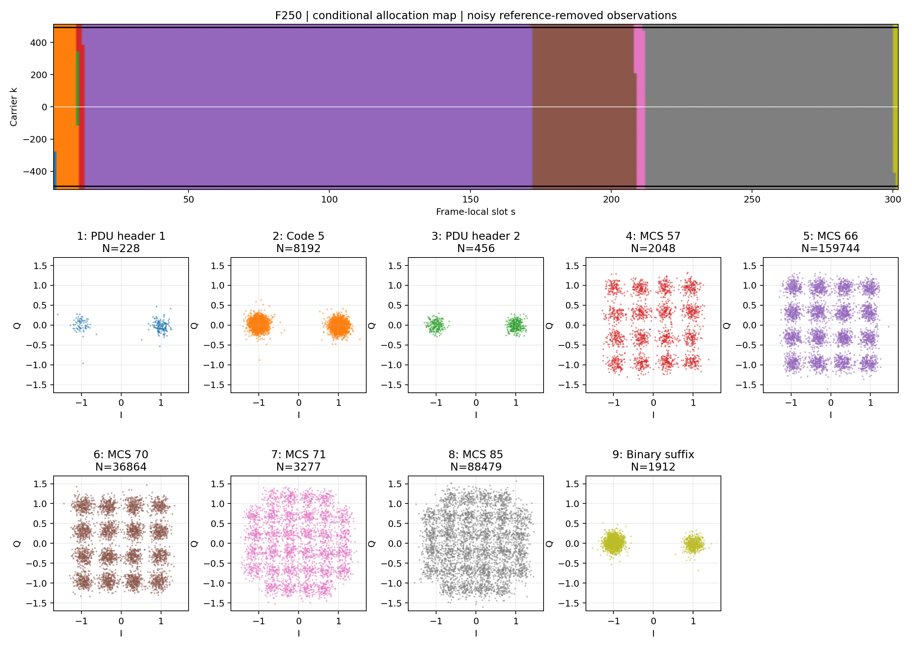
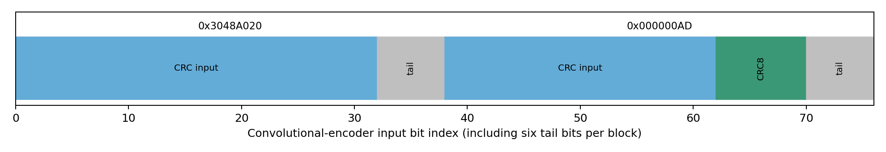
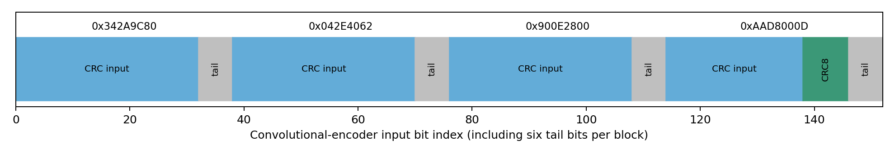

**English** | [简体中文](../README.zh-CN.md)

> **Dataset notice:** At the data provider’s request, the original approximately24 ms recording is temporarily unavailable. The explanation below now uses [raw IQ from UT Austin](https://rnl-data.ae.utexas.edu/datastore/supplementaryMaterial/qin-starlink-pilots/raw-iq-data/) (`exemplar250-257.zip`), supplied with the [Qin et al. study](https://doi.org/10.1038/s44459-026-00075-6). The unmodified50 ms recording contains nine complete validated frames, plus other candidates and a truncated frame.

> **Please cite our paper** if you use this dataset, analysis, or research results: [Protocol Data Unit Header Decoding and Payload Coding Recovery in the Starlink Ku-Band Downlink](https://arxiv.org/abs/2610.29387v2). See [Citation](#citation) for BibTeX.

[Research paper (PDF)](../paper/Starlink_Downlink_Analysis.pdf) · [Download raw IQ (50 MB)](https://github.com/misaka666/Starlink-Downlink-Analysis/releases/download/v2.0.0/Starlink_Downlink_IQ_250MSps.bin) · [Release v2.0.0](https://github.com/misaka666/Starlink-Downlink-Analysis/releases/tag/v2.0.0)

---

# Inside the Starlink Downlink: Frame Structure, PDU Headers, and Payload Coding

A spectrum or constellation plot can reveal the bandwidth and modulation features of a Starlink downlink recording. Explaining which resources carry headers, how those headers describe the payload, and which channel codes protect each region requires a more complete connection between the waveform, decoded control bits, and coding relations.

This article summarizes nine complete frames identified in the UT Austin recording. It checks two PDU headers per frame against the previously recovered convolutional encoder and CRC, interprets candidate MCS fields, and validates the frozen code5 QC-LDPC relation. Other payload formats are distinguished from confirmed coding results.

The focus here is **what we can currently say about the contents of a frame**. We briefly review the established synchronization and pilot structure, then concentrate on the headers, resource allocations, and payload coding. Format numbers follow the MCS index interpretation used in the current manuscript.

## 1. The Basic Frame Structure

The raw recording contains12,500,000 complex samples at250 MS/s, spanning50 ms. Samples are interleaved little-endian signed int16 I,Q. Nine complete validated frames are used below; truncated F257 is excluded. The provided record labels do not establish a decoded on-air sequence number.

The main time–frequency parameters and synchronization sequences of the Starlink downlink have already been described in public research. We use the frame grid established by [Humphreys et al.](https://arxiv.org/abs/2210.11578), together with the edge-pilot references described by [Qin et al.](https://doi.org/10.1038/s44459-026-00075-6). These known structures provide the basis for the analysis below.

| Parameter | Value or representation used here |
| --- | --- |
| Receiver sampling rate | 250 MHz; equivalent OFDM processing grid240 MHz |
| Ordinary OFDM FFT / cyclic prefix | 1024 / 32 on the equivalent240 MHz grid; only the latter half of the prefix was verified as a repeated segment in this receiver |
| Subcarrier spacing | 234.375 kHz |
| Ordinary slot duration | 4.4 μs, including the cyclic prefix |
| Nominal frame rate / period | 750 frames/s, approximately 1.333333 ms |
| Occupied slot intervals per frame | 302, numbered 0–301 |
| Resource interval analyzed below | Slots 2–301, comprising 300 OFDM symbols |
| Loaded subcarriers per ordinary slot | 1020, including 16 edge pilots |
| Non-pilot resources per ordinary slot | 1004 |
| Non-pilot resources across slots 2–301 | 301,200 modulation symbols |

Two uses of the word “symbol” need to be distinguished. One OFDM symbol occupies one slot. A complex value on one subcarrier in one slot is a **modulation symbol**. When we say that an allocation contains 8192 symbols, we mean 8192 subcarrier modulation symbols.

Using the terminology of the published frame description, a frame contains the PSS, SSS, ordinary body, CM1SS, CSS, and inter-frame guard. The primary synchronization sequence (PSS) occupies slot 0, and the secondary synchronization sequence (SSS) occupies slot 1. CM1SS and CSS are the published names associated with slots 300 and 301. In our recording, CM1SS and CSS are not identical in every frame, so those positions cannot simply be treated as universally fixed synchronization content.

In frequency, the equivalent loaded-carrier indices run from −512 to −3 and from +2 to +511, leaving four central nulls. The 16 edge pilots occupy −496 through −489 and +488 through +495. The250 MHz recording does not fully cover the left-side out-of-band nine-tone region examined in the old capture, so that observation is not claimed here.

## 2. Reading the Resource Coordinates

We identify a resource by `(s, q, k)`. Here, `s` is the frame-local slot index, `k` is the signed subcarrier index, and `q` is the resource ordinal within that slot after skipping pilots and DC nulls. The range of `q` is 0–1003.

For example, `(2, 0, −512)` is the first non-pilot resource in slot 2, on subcarrier −512. The coordinate `(10, 843, +343)` refers to non-pilot ordinal843 in slot10, on subcarrier+343.

Headers and payload are ordered **from lower to higher frequency within a slot, followed by the next slot**. Two fields can therefore occupy different subcarriers in the same slot. Their boundary does not have to coincide with the start of an OFDM symbol.

We use **F250** as the worked example. F250 is a supplied record label. The nine frames are F250–F256,G13 andG29; G13/G29 denote additional candidate identifiers, not on-air frame counters.



*Figure1. F250 working resource map and noisy reference-removed constellations. Later MCS boundaries are conditional. Black marks pilots; white marks DC. N is the region symbol count; each constellation displays at most4000 received points.*

## 3. A Common Phase Convention for the Constellations

Before interpreting Figure1, we specify the processing convention. Following frequency, timing and channel correction, an equalized non-pilot symbol is multiplied by the conjugate of a frozen position-dependent reference `R(s,k)`. Its four-phase values follow the declared receiver convention. This is consistent with the patent's rotational scrambling mechanism; it is a cross-capture check, not a new discovery of PN rotation. [US12074683B1](https://patents.google.com/patent/US12074683B1/en)

The refined receiver uses PSS/SSS for timing and smooth channel estimation, then pilots for residual frequency, timing-slope and common-phase tracking. In the separate eight-fit/eight-reserved pilot branch, the nine-frame average reserved-pilot EVM is0.2212. This is a receiver-quality measurement, not a payload BER. The production branch uses all16 pilots; these two scopes are distinct.

**All constellation panels use noisy received observations after PN reference removal.** No separate rotation is fitted to each unknown region. Two-point clusters remain in both PDU headers and the intervening code5 region. This processing does not decrypt application data.

## 4. Two PDU Headers in Each Frame

Each of the nine complete frames contains two coded units, each protected by a CRC covering that unit. Based on their relationships to the following resources and the patent's protocol data unit description, we refer to them as the first and second **PDU headers**. PDU stands for *protocol data unit*.

### Short Convolutionally Encoded Blocks

Each coding block occupies **114 BPSK resources**. It takes 32 retained bits and six zero tail bits as input to a rate-1/3 convolutional encoder:

```text
32 retained bits + 6 zero tail bits
              ↓ rate-1/3 convolutional encoding
          114 coded bits
              ↓ BPSK mapping
          114 modulation symbols
```

The recovered convolutional code has constraint length seven. Under the register direction and output ordering declared in the manuscript, its generator polynomials are **(155, 123, 137) in octal**.

The 32 retained bits are not necessarily 32 bits of user data. In the final coding block, they include the header CRC. The six zero tail bits terminate the encoder state for that block and are excluded from the CRC calculation.

Header1 always contains two blocks/228 resources, at(2,0,-512)–(2,227,-277). Header2 contains four blocks/456 resources in eight frames and five blocks/570 resources in F252. Four blocks retain128 bits with120 CRC input bits; five retain160 with152 CRC input bits. Header2 starts in slot10 for eight frames and slot8 for F256. It is not a fixed slot12 field.

|Frame / 帧|code5 words / 字数|PDU2 blocks / 块数|PDU2 fields / 字段数|
|---|---:|---:|---:|
|F250|4|4|5|
|F251|4|4|4|
|F252|4|5|6|
|G13|4|4|5|
|F253|4|4|5|
|F254|4|4|5|
|F255|4|4|4|
|G29|4|4|5|
|F256|3|4|4|

### A CRC Over the Header, Not the Entire Frame

After removing the six tail bits from each block, we concatenate the 32 retained bits from successive blocks in resource order. The final eight bits are the received CRC. All preceding retained bits form the CRC input.

The recovered parameters are polynomial `x^8 + x^6 + x^3 + x^2 + 1`, eight-bit mask `0x4D`, initial register `0xFF`, final XOR zero, most-significant-bit-first processing, and no input or output reflection.



*Figure2. F250 first header: blue56 CRC-input bits, green8 CRC bits, gray six tail bits per block; the axis counts encoder inputs.*



*Figure3. F250 second header:120 CRC-input bits,8 CRC bits and four independent tails. These inputs are convolutionally encoded before transmission.*

F250 decodes to `0x3048A020,0x000000AD` in header1, with CRC `0xAD`. Header2 decodes to `0x342A9C80,0x042E4062,0x900E2800,0xAAD8000D`, with CRC `0x0D`. All18 headers pass the frozen CRC parameters; none is used to re-fit the polynomial.

## 5. How the Headers Describe the Following Resources

After tail removal, the conditional layout remains:

```text
16-bit candidate prefix
+ D × 20-bit MCS index–length pairs
+ remaining zero-valued bits
+ 8-bit CRC
```

The first16 bits of header1 agree across these nine frames. Header2 varies in block count and candidate pair count. `D` counts MCS pairs, not the header's114-bit coding blocks or the total payload codewords.

### MCS Index and Quantity

Two20-bit interpretations are retained:

```text
Candidate1: 7-bit MCS index + 1 unresolved bit + 12-bit quantity
Candidate2: 8-bit MCS index                    + 12-bit quantity
```

Fields use increasing bit weights in received order. The eighth bit is zero in the52 pairs from the18 headers, so these interpretations remain indistinguishable. Wider indices distinguish MCS66/70/71/85 from their lower six-bit labels; this does not authenticate a standard table.

Header1 gives `(5,4)` in eight frames and `(5,3)` in F256. The measured BPSK allocations contain8192 or6144 symbols, exactly quantity×2048. This relationship holds in all nine complete frames and is further checked by the frozen code5 encoder.

The patent describes MCS as specifying coding/modulation and length as describing payload size. Its wording motivates testing the fields; it does not determine their bit width or units in this recording. [US12074683B1](https://patents.google.com/patent/US12074683B1/en)

### From a Quantity to an Allocation Length

```text
Symbols per codeword = ceil(codeword bits / coded bits per symbol)
Symbols in allocation = codeword count × symbols per codeword
```

For code5,2048 coded bits and BPSK give2048 symbols per word. F250's four words therefore occupy8192 resources. Candidate units for the later fields are used in the map below, but their successful numerical packing is not proof of their encoders. The old code28 final-symbol experiment is not counted as a new nine-frame result.

Both19- and20-bit layouts pass the recorded capacity/residual-zero tests in this capture. Twenty bits is a conditional working model. Neither its uniqueness nor every higher-layer field meaning is established here.

## 6. A Complete Allocation Map for F250

F250 header1 gives `(5,4)`. Under the20-bit working model, header2 gives `(57,1)`, `(66,39)`, `(70,9)`, `(71,1)` and `(85,27)`. Each pair lists an index followed by a quantity.

The following full map combines the verified header/code5 positions with candidate later resource units. Endpoints are inclusive. Later MCS boundaries are conditional and are not inferred solely from constellation changes.

|Region|Contents|Start `(s,q,k)`|End `(s,q,k)`|Modulation symbols|
|---|---|---|---|---:|
|1|PDU header 1|`(2,0,-512)`|`(2,227,-277)`|228|
|2|Code 5|`(2,228,-276)`|`(10,387,-117)`|8,192|
|3|PDU header 2|`(10,388,-116)`|`(10,843,+343)`|456|
|4|MCS 57|`(10,844,+344)`|`(12,883,+383)`|2,048|
|5|MCS 66|`(12,884,+384)`|`(171,991,+499)`|159,744|
|6|MCS 70|`(171,992,+500)`|`(208,707,+207)`|36,864|
|7|MCS 71|`(208,708,+208)`|`(211,972,+472)`|3,277|
|8|MCS 85|`(211,973,+473)`|`(300,95,-409)`|88,479|
|9|Binary suffix|`(300,96,-408)`|`(301,1003,+511)`|1,912|

The nine regions total301200 non-pilot symbols. The final1912-symbol region is a binary suffix, not an independently verified constant-reference fill. Headers and code5 are BPSK; the later observations support sixteen-point and cross-shaped32-point models, with residual noise. Similar constellations do not establish shared coding or the absence of an allocation boundary.

## 7. What Has Been Recovered About Payload Coding?

The table lists only the code5 result validated on these nine complete frames. `N` is the number of coded bits and `K` the systematic-input dimension, not the application payload length.

|MCS index|Modulation after PN reference removal|Verified coding relation|Rate|Symbols per codeword|
|---|---|---|---|---:|
|5|BPSK|Equivalent QC-LDPC representation, N=2048,K=1024,lifting factor Z=128|1/2|2048|

In the UT Austin recording, the two PDU headers and the intervening code5 allocation are BPSK, whereas the later payload predominantly exhibits16QAM and cross-shaped32QAM. Its MCS indices and modulation combinations differ substantially from those analyzed in the paper's24 ms recording. The other coding results from the paper are therefore not directly assigned to this capture. Those coding schemes remain under investigation.

### Evidence Behind the Coding Results

The previously recovered systematic-to-parity generator P and complete sparse parity-check matrix H are frozen and tested on the new observations, rather than re-fitted to these nine frames. With the refined PSS/SSS/pilot receiver, all35 hard-decision code5 words satisfy the complete checks. All35840 received parity bits are predicted without disagreement, and re-encoding reproduces the received hard decisions.

These results support the applicability of the code5 relation to this separate capture. Zero disagreement in a finite sample is not an independently measured zero channel BER and does not reveal the application meaning of the systematic bits.

## 8. Terminal Padding

The paper's24 ms recording and the UT Austin recording exhibit different terminal behavior.

In some frames of the paper's recording, varying payload is followed by symbols that remain close to the PN phase reference. After reference removal, they cluster near a constant, motivating the observational term reference-symbol padding. In R02, this region starts at `(297,815,+315)` and contains4205 non-pilot symbols. It retains received power and is distinct from the silent inter-frame guard. This behavior is not universal across all frames.

The UT Austin recording instead shows a BPSK two-point tail after removal of the same type of reference phase. F250's working allocation map leaves1912 binary symbols at the end. A binary constellation alone does not establish that this is code5, and the constant-reference interpretation of the paper's R02 should not be transferred to it.

|Comparison|Paper's24 ms recording|UT Austin raw IQ recording|
|---|---|---|
|Representative tail after PN reference removal|Persistent near-constant observations in some frames|BPSK two-point observations in the analyzed tails|
|Example|R02:4205 reference-consistent symbols|F250:1912 binary symbols in the working map|
|Current interpretation|Observed reference-symbol padding|Candidate binary terminal padding; generation and purpose unconfirmed|

The old constant-reference endpoint model finds no nonempty constant suffix in the nine complete UT Austin frames. This identifies a limitation of that model; it does not prove that payload fills all remaining resources. The1912-symbol F250 boundary comes from the working allocation model, not an independent endpoint detection.

Terminal padding must therefore be described together with the dataset and receiver convention. A compatible physical frame grid does not require identical terminal content. Whether configuration or transmission mode explains the difference, and how the binary sequence is generated, remain open questions.

## From a Constellation Plot to a Frame Description

The UT Austin recording supports the same physical grid, two CRC-checked PDU headers, and the frozen code5 encoder on nine complete frames. Later MCS allocations remain working interpretations; their encoders and binary tail semantics are not established by these checks. The retained paper describes the original research and is cited for those methods, not as nine-frame experimental truth.

---

### Public References

- UT Austin, [raw IQ dataset and `exemplar250-257.zip`](https://rnl-data.ae.utexas.edu/datastore/supplementaryMaterial/qin-starlink-pilots/raw-iq-data/), supplementary data accompanying Qin et al.

- Humphreys et al., [Signal Structure of the Starlink Ku-Band Downlink](https://arxiv.org/abs/2210.11578): principal downlink time–frequency parameters and synchronization sequences.
- Qin et al., [Pilots and Other Predictable Elements of the Starlink Ku-Band Downlink](https://doi.org/10.1038/s44459-026-00075-6): edge pilots and predictable reference elements.
- SpaceX, [US12074683B1](https://patents.google.com/patent/US12074683B1/en): public descriptions of downlink OFDM, header processing, and payload processing.
- SpaceX, [US11792832B1](https://patents.google.com/patent/US11792832B1/en): adaptive modulation and coding, including an illustrative MCS table.

*This article is a technical overview of our research manuscript, “Protocol Data Unit Header Decoding and Payload Coding Recovery in the Starlink Ku-Band Downlink.” Numerical results and their scope follow the experimental definitions in that manuscript.*

## Citation

If you use this dataset, analysis, or research results in your work, please cite our arXiv paper:

Haoyan Liu, Yichuan Ma, Haotong Zhao, Chengguang Li, and Min Yang. **[Protocol Data Unit Header Decoding and Payload Coding Recovery in the Starlink Ku-Band Downlink](https://arxiv.org/abs/2610.29387v2)**. arXiv:2610.29387v2 [eess.SP], 2026 (version 2).

```bibtex
@misc{liu2026starlinkdownlink,
  title         = {Protocol Data Unit Header Decoding and Payload Coding Recovery in the {Starlink} {Ku-Band} Downlink},
  author        = {Haoyan Liu and Yichuan Ma and Haotong Zhao and Chengguang Li and Min Yang},
  year          = {2026},
  eprint        = {2610.29387v2},
  archivePrefix = {arXiv},
  primaryClass  = {eess.SP},
  note          = {Version 2},
  url           = {https://arxiv.org/abs/2610.29387v2}
}
```
