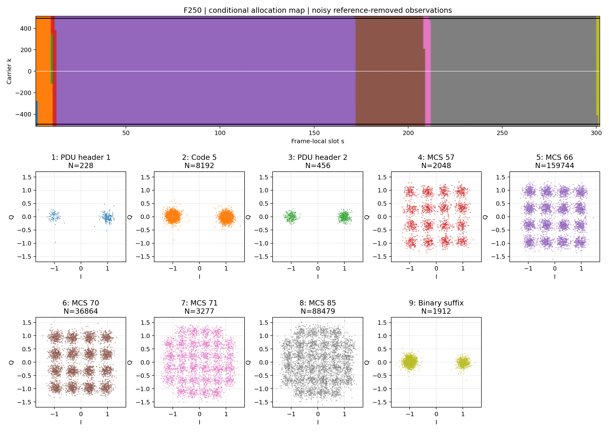
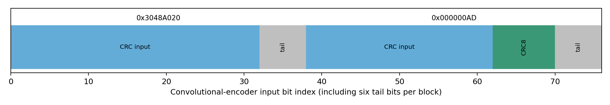
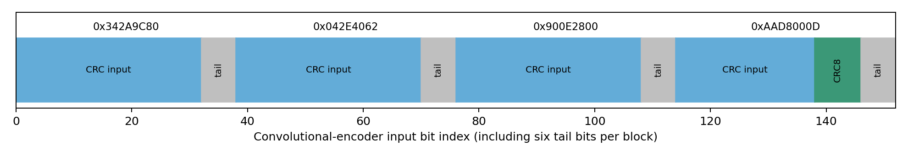

[English](../README.md) | **简体中文**

> **数据说明：**应数据提供者要求，原约24 ms数据暂时下架。下文改用[UT Austin公开的原始IQ](https://rnl-data.ae.utexas.edu/datastore/supplementaryMaterial/qin-starlink-pilots/raw-iq-data/)（`exemplar250-257.zip`）进行解析说明，数据出处为[Qin等人的配套研究材料](https://doi.org/10.1038/s44459-026-00075-6)。原始记录长50 ms，其中有9个完整已验证帧，另含其他候选信号及截断帧。

> **请引用我们的论文**：如果您在研究中使用本数据集、分析内容或研究结果，请引用 [Protocol Data Unit Header Decoding and Payload Coding Recovery in the Starlink Ku-Band Downlink](https://arxiv.org/abs/2610.29387v2)。BibTeX 格式见[引用](#引用)。

[英文论文 PDF](../paper/Starlink_Downlink_Analysis.pdf) · [下载原始IQ（50 MB）](https://github.com/misaka666/Starlink-Downlink-Analysis/releases/download/v2.0.0/Starlink_Downlink_IQ_250MSps.bin) · [Release v2.0.0](https://github.com/misaka666/Starlink-Downlink-Analysis/releases/tag/v2.0.0)

---

# 星链下行信号里有什么：帧结构、PDU 头部与载荷编码解析

把一段星链下行 IQ 信号画成频谱或星座图，可以看见它的带宽和调制特征。但如果想回答“一帧中哪些位置是头部、头部怎样描述载荷、不同区域采用什么编码”，就需要把波形、控制比特和编码关系对应起来。

这篇文章整理UT Austin原始IQ中9个完整帧的解析结果。以既有卷积编码器和CRC检验每帧两个PDU头部，读取候选MCS字段，并验证冻结的code5 QC-LDPC编码关系。后部格式的观测与已确认编码结论分开说明。

下文重点介绍**目前能把这一帧解释到什么程度**。已知的同步与导频结构会简要回顾，主要篇幅留给头部、资源分配和载荷编码。文中的代码编号沿用论文当前采用的 MCS 索引解释。

## 1. 一帧的基本骨架

原始记录采用250 MS/s采样，共1250万复样本、时长50 ms，格式为小端交织有符号int16 I/Q。下文只统计9个完整已验证帧，截断F257不计入。记录标签不是已译出的空口序列号。

星链下行的主要时频参数和同步序列，已有公开研究给出了详细描述。我们的帧网格采用 [Humphreys 等人的下行结构研究](https://arxiv.org/abs/2210.11578)，边缘导频参考采用 [Qin 等人对导频及其他可预测元素的研究](https://doi.org/10.1038/s44459-026-00075-6)。这些已知结构是后续解析的基础。

| 参数 | 本文采用的值或表示 |
| --- | --- |
| 接收采样率 | 250 MHz；等效OFDM处理网格240 MHz |
| 普通 OFDM 符号的 FFT／循环前缀 | 等效240 MHz网格为1024／32；本接收机以前缀后半段确认重复关系 |
| 子载波间隔 | 234.375 kHz |
| 普通 slot 时长 | 4.4 μs，包含循环前缀 |
| 标称帧率／帧周期 | 750 帧/s，约 1.333333 ms |
| 每帧占用的 slot 区间 | 302 个，编号 0–301 |
| 后续分析的资源区间 | slot 2–301，共 300 个 OFDM 符号 |
| 每个普通 slot 的加载子载波 | 1020 个，其中 16 个为边缘导频 |
| 每个普通 slot 的非导频资源 | 1004 个 |
| slot 2–301 的非导频资源总量 | 301,200 个调制符号 |

这里需要区分两个“符号”：一个 OFDM 符号对应一个 slot，而一个子载波在一个 slot 上的复数值，是一个**调制符号**。后文说某段有 8192 个符号，指的是 8192 个子载波调制符号。

按公开文献的命名，一帧依次包含 PSS、SSS、普通主体区、CM1SS、CSS 和帧间保护区。PSS 位于 slot 0，SSS 位于 slot 1。CM1SS 与 CSS 对应 slot 300、301 的已发表位置命名。对于本文数据，这些末端 slot 的非导频内容并非每帧都完全相同，因此不能直接把它们全部视为固定同步序列。

频域上，等效子载波编号为 −512 至 −3，以及 +2 至 +511，中间有四个空载波。16 个边缘导频分别位于 −496…−489 和 +488…+495。本250 MHz采样记录不完整覆盖旧采集中频带左侧的九音区域，因此不将该带外观测算作本次验证。

## 2. 怎么读后面的资源坐标

本文用 `(s, q, k)` 标记一个资源位置。`s` 是帧内 slot 编号，`k` 是有正负号的子载波编号。`q` 是该 slot 内跳过导频和直流空载波后的资源序号，范围为 0–1003。

例如，`(2, 0, −512)` 表示 slot 2 的第一个非导频资源，位于子载波 −512。`(10, 843, +343)` 表示 slot10中序号为843的非导频资源，位于子载波+343。

头部和载荷沿着“**同一 slot 内从低频到高频，再进入下一个 slot**”的顺序排列。因此，两个字段可以在同一个 slot 中占用不同子载波。它们的分界不一定落在完整 OFDM 符号的时间边界上。

下面统一以 **F250** 为例。9个完整帧为F250–F256、G13、G29；G13／G29是额外检出候选的编号，不是空口帧计数。



*图1：F250工作资源分区及去PN参考相位后的含噪星座。后部MCS边界仍为条件模型；黑色为导频，白色为直流空载波。N为区域符号数，单幅星座最多展示4000个接收点。*

## 3. PN 相位去除后，才能统一比较各段星座

解释图1前，需要说明接收处理约定。均衡后的非导频符号乘以冻结参考 `R(s,k)` 的共轭，去除随资源位置变化的四相旋转。该参考与SpaceX专利中的旋转扰码机制相容。本次检验的是其跨采集适用性，不把PN相位作为新发现。[US12074683B1](https://patents.google.com/patent/US12074683B1/en)

更新后的接收机用PSS／SSS细化定时并估计平滑信道，用导频跟踪残余频偏、定时相位斜率和公共相位。独立的8拟合／8保留导频分支中，9帧保留导频平均EVM为0.2212。该指标描述接收质量，不是载荷误码率；生产分支使用全部16个导频，两者范围不能混淆。

**本文星座均为去PN参考相位后的含噪接收值。**没有对每个未知区域单独拟合旋转，也没有用理想硬判决点替代实测点。两个PDU头部与中间code5区域呈两点聚类。这不等于解密应用数据。

## 4. 每帧中的两个 PDU 头部

在这9个完整帧中，每帧都识别到两个由 CRC 共同校验的编码单元。结合它们与后续资源的对应关系，以及专利中的协议数据单元描述，论文将其称为第一、第二 **PDU 头部**。PDU 是 protocol data unit，即协议数据单元。

### 头部采用相同的短卷积编码块

每个编码块占用 **114 个 BPSK 资源**。其输入包含 32 个保留位和 6 个零尾位，经率 1/3 卷积编码后输出 114 位：

```text
32 个保留位 + 6 个零尾位
          ↓ 率 1/3 卷积编码
       114 个编码位
          ↓ BPSK 映射
       114 个调制符号
```

恢复出的卷积码约束长度为 7，生成多项式按论文声明的寄存器方向和输出顺序写为八进制 **(155, 123, 137)**。

“32 个保留位”并不意味着每块都有 32 位业务数据：最后一个编码块的 32 位中包含头部 CRC。六个零尾位用于结束该块的卷积编码状态，不参加 CRC 计算。

第一头部均含两块、228资源，位于(2,0,-512)至(2,227,-277)。第二头部在8帧中为四块／456资源，F252为五块／570资源：四块去尾保留128位、CRC输入120位，五块保留160位、CRC输入152位。8帧第二头部从slot10开始，F256从slot8开始，不能称为固定slot12头部。

|Frame / 帧|code5 words / 字数|PDU2 blocks / 块数|PDU2 fields / 字段数|
|---|---:|---:|---:|
|F250|4|4|5|
|F251|4|4|4|
|F252|4|5|6|
|G13|4|4|5|
|F253|4|4|5|
|F254|4|4|5|
|F255|4|4|4|
|G29|4|4|5|
|F256|3|4|4|

### CRC 校验的是一个头部，而不是整帧

去掉每块的六个零尾位后，将各块的 32 个保留位按资源顺序拼接。拼接结果的最后八位为 CRC，其前面的所有保留位作为 CRC 输入。

恢复出的参数为：多项式 `x^8 + x^6 + x^3 + x^2 + 1`，八位掩码 `0x4D`，初值 `0xFF`，最终异或为零，按最高位优先处理，输入输出均不反射。



*图2：F250第一头部。蓝色为56个CRC输入位，绿色为8个CRC位，灰色为每块六零尾位。横轴统计卷积编码器输入。*



*图3：F250第二头部。蓝色合计120个CRC输入位，绿色为8个CRC位，四块均有独立尾位；这些输入均经过卷积编码才发送。*

F250第一头部译码字为 `0x3048A020、0x000000AD`，CRC为 `0xAD`。第二头部为 `0x342A9C80、0x042E4062、0x900E2800、0xAAD8000D`，CRC为 `0x0D`。9帧18个头部均通过冻结CRC参数，没有用它们重新选择多项式。

## 5. 头部怎样告诉接收机“后面有什么”

去掉每块尾位后，仍采用以下条件性布局：

```text
16位候选前缀
+ D个20位MCS索引—长度对
+ 剩余零位
+ 8位CRC
```

第一头部前16位在这9帧中一致；第二头部的块数与候选字段数发生变化。`D`表示MCS对数量，不是头部114位编码块数量，也不是后续载荷码字总数。

### MCS 索引和数量字段

每个20位单元保留两种解释：

```text
候选一：7位MCS索引 + 1位未解释字段 + 12位数量
候选二：8位MCS索引                 + 12位数量
```

字段内按接收顺序赋递增位权。18个头部共52个候选对，第八位均为零，两种解释仍无法区分。更宽的索引把MCS66／70／71／85与其低六位标签区分开，但不因此认证某份标准MCS表。

第一头部在8帧给出 `(5,4)`，在F256给出 `(5,3)`。两头部之间实测BPSK区域分别为8192、6144个符号，等于数量乘2048。这一关系对9个完整帧全部成立，并由冻结code5编码器进一步核对。

专利关于“MCS指定调制编码、长度字段描述载荷大小”的说明提供功能线索；接收数据仍需检验其具体位宽和数量单位。[US12074683B1](https://patents.google.com/patent/US12074683B1/en)

### 数量如何换算成区域长度

```text
每码字符号数 = 向上取整（编码位数 ÷ 每符号编码位数）
区域符号数   = 码字数量 × 每码字符号数
```

code5采用2048编码位和BPSK，每码字恰占2048符号。F250数量为4，因此占8192资源。后部格式的候选单位用于下节工作分区图，但长度能拼齐不能单独证明其编码器。旧code28末符号实验不计入本次9帧的新验证。

这组数据中，19位和20位排列均通过已保存的容量／剩余零位检查。20位仍为条件工作模型，尚未唯一确定，也没有因此确认所有业务字段含义。

## 6. 把 F250 从头到尾展开

F250第一头部给出 `(5,4)`。第二头部按20位工作模型给出 `(57,1)`、`(66,39)`、`(70,9)`、`(71,1)`、`(85,27)`。括号内依次为索引和数量。

下表保留一帧完整分区的展示方式。头部与code5有编码证据，后部按候选资源单位展开，边界仍有条件。各端点均包含，符号数排除导频和直流空载波。

|区域|内容|起点 `(s,q,k)`|终点 `(s,q,k)`|调制符号数|
|---|---|---|---|---:|
|1|第一PDU头部|`(2,0,-512)`|`(2,227,-277)`|228|
|2|Code 5|`(2,228,-276)`|`(10,387,-117)`|8,192|
|3|第二PDU头部|`(10,388,-116)`|`(10,843,+343)`|456|
|4|MCS 57|`(10,844,+344)`|`(12,883,+383)`|2,048|
|5|MCS 66|`(12,884,+384)`|`(171,991,+499)`|159,744|
|6|MCS 70|`(171,992,+500)`|`(208,707,+207)`|36,864|
|7|MCS 71|`(208,708,+208)`|`(211,972,+472)`|3,277|
|8|MCS 85|`(211,973,+473)`|`(300,95,-409)`|88,479|
|9|二元尾段|`(300,96,-408)`|`(301,1003,+511)`|1,912|

9个区域合计301200个非导频符号。最后1912符号呈二元尾段，不能改称已经独立确认的恒定参考填充。头部与code5为BPSK，后部观测支持十六点和交叉形32点模型，并仍含接收噪声。星座相似不证明编码相同，也不能用来排除同调制区域之间的资源边界。

## 7. 载荷编码恢复到了什么程度

下表仅列出在这9个完整帧上得到验证的code5结果。`N`为编码位数，`K`为系统输入维数，不直接等于应用层有效信息长度。

|MCS索引|去PN参考相位后的调制|已验证编码关系|码率|每码字符号数|
|---|---|---|---|---:|
|5|BPSK|QC-LDPC等价表示，N=2048、K=1024、提升因子Z=128|1/2|2048|

UT Austin数据中，两个PDU头部及其间的code5区域采用BPSK，后部载荷观测到的调制方式主要为16QAM和交叉形32QAM。与论文24 ms数据中分析的MCS组合相比，这段记录的MCS索引与调制组合差异较大。因此不将论文中其他格式的编码结果直接套用于本数据，其编码方案仍在解析中。

### 编码结论有什么验证支撑

使用既有研究中已经恢复并冻结的系统位到校验位生成矩阵P和完整稀疏校验矩阵H，对新数据进行检验，不用这9帧重新拟合编码器。采用更新后的PSS／SSS／导频接收校正，35个code5硬判决码字全部满足完整校验关系，35840个接收校验位预测零差异，重编码也与接收硬判决一致。

这些结果支持code5编码关系在该段独立采集中的适用性。有限样本的零差异不等于独立测得零信道误码率，也不直接揭示系统位中的应用层内容。

## 8. 帧尾填充部分

论文中的24 ms数据与UT Austin数据，在帧尾呈现出不同的观测特征。

在论文24 ms记录的若干帧中，变化载荷之后出现持续与PN相位参考接近的符号。去掉PN参考相位后，这些符号聚于接近一个常数的位置，因此称为“参考符号填充”。以论文R02为例，该区域从 `(297,815,+315)` 开始，共4205个非导频符号。它仍有接收功率，与帧间静默guard不同；这一现象并非所有帧都必然出现。

UT Austin记录的尾部则表现不同：去除同一类PN参考相位后，仍可见BPSK两点分布，而不是持续聚于单点。以F250为例，工作资源分区图末端有1912个二元符号。不能因为它同样呈BPSK，就将其认定为code5，也不能直接沿用论文R02的恒定参考填充解释。

|对比项|论文中的24 ms记录|UT Austin原始IQ记录|
|---|---|---|
|去PN参考相位后的代表性尾部|部分帧持续聚于接近一个常数的位置|所分析尾段仍呈BPSK两点分布|
|具体示例|R02：4205个参考一致符号|F250：工作模型末端1912个二元符号|
|当前解释|参考符号填充的观测表示|二元尾部填充候选，具体生成方式与用途未确认|

对UT Austin的9个完整帧，原恒定参考端点模型未找到非空恒定尾段。这反映该模型在新记录中的局限，不能据此断言载荷占满全部剩余资源。F250的1912符号边界来自工作分配模型，不是独立端点检出的证明。

因此，帧尾填充应与数据集及接收处理约定一起说明。相容的物理帧网格并不要求相同的填充内容，其是否受配置或发送模式影响、二元序列怎样生成，仍需继续验证。

## 从一张星座图，到一帧可核对的结构

UT Austin这段记录在9个完整帧上支持相容的物理网格、两个CRC校验PDU头部和冻结code5编码器。后部MCS资源仍按工作模型解释，其编码器与二元尾段含义不由这些检验确认。仓库保留的论文说明原研究及方法，不作为9帧实验统计的替代。

---

### 公开参考资料

- UT Austin：[原始IQ数据目录及 `exemplar250-257.zip`](https://rnl-data.ae.utexas.edu/datastore/supplementaryMaterial/qin-starlink-pilots/raw-iq-data/)，Qin等人研究的配套数据。

- Humphreys 等：[Signal Structure of the Starlink Ku-Band Downlink](https://arxiv.org/abs/2210.11578)。下行主要时频参数与同步序列。
- Qin 等：[Pilots and Other Predictable Elements of the Starlink Ku-Band Downlink](https://doi.org/10.1038/s44459-026-00075-6)。边缘导频与可预测参考元素。
- SpaceX：[US12074683B1](https://patents.google.com/patent/US12074683B1/en)。下行 OFDM、头部与载荷处理等公开机制。
- SpaceX：[US11792832B1](https://patents.google.com/patent/US11792832B1/en)。自适应调制编码及示例 MCS 表。

*本文为研究稿《Protocol Data Unit Header Decoding and Payload Coding Recovery in the Starlink Ku-Band Downlink》的中文技术解读。具体数值及适用范围以研究稿中的实验定义为准。*

## 引用

如果您在研究中使用本数据集、分析内容或研究结果，请引用以下 arXiv 论文：

Haoyan Liu, Yichuan Ma, Haotong Zhao, Chengguang Li, and Min Yang. **[Protocol Data Unit Header Decoding and Payload Coding Recovery in the Starlink Ku-Band Downlink](https://arxiv.org/abs/2610.29387v2)**. arXiv:2610.29387v2 [eess.SP], 2026（v2 版本）。

```bibtex
@misc{liu2026starlinkdownlink,
  title         = {Protocol Data Unit Header Decoding and Payload Coding Recovery in the {Starlink} {Ku-Band} Downlink},
  author        = {Haoyan Liu and Yichuan Ma and Haotong Zhao and Chengguang Li and Min Yang},
  year          = {2026},
  eprint        = {2610.29387v2},
  archivePrefix = {arXiv},
  primaryClass  = {eess.SP},
  note          = {Version 2},
  url           = {https://arxiv.org/abs/2610.29387v2}
}
```
